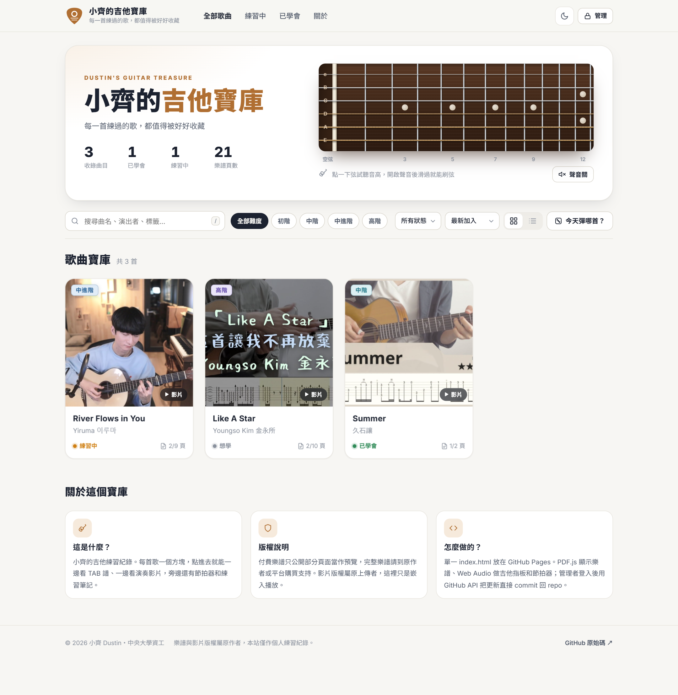
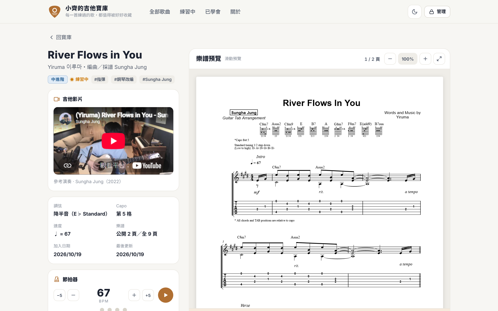
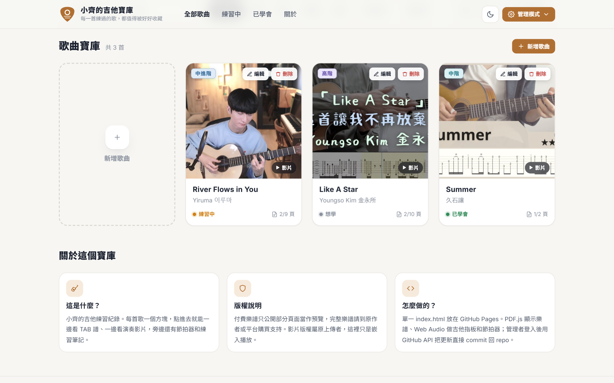
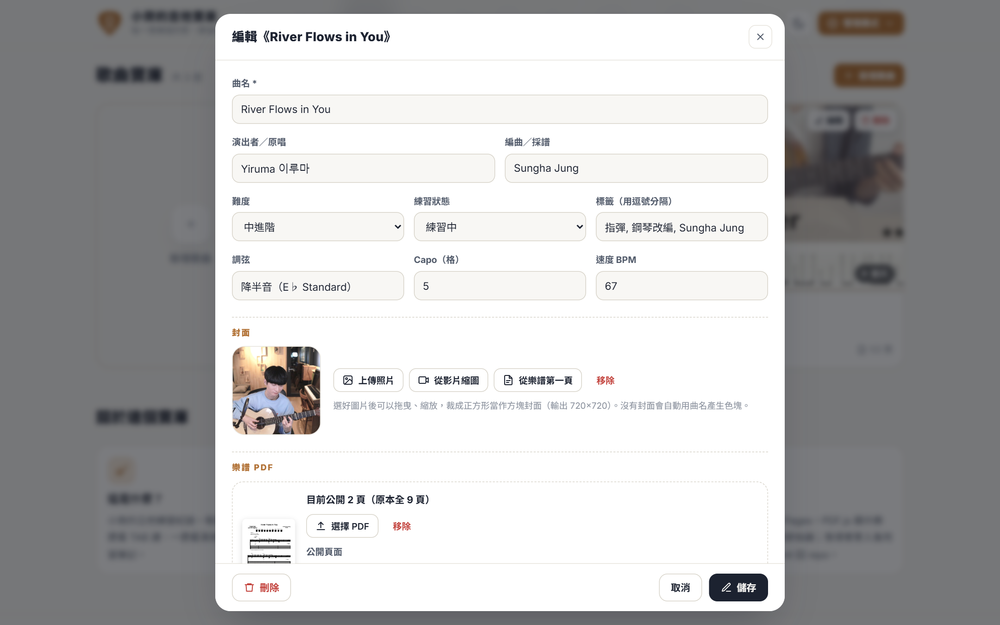
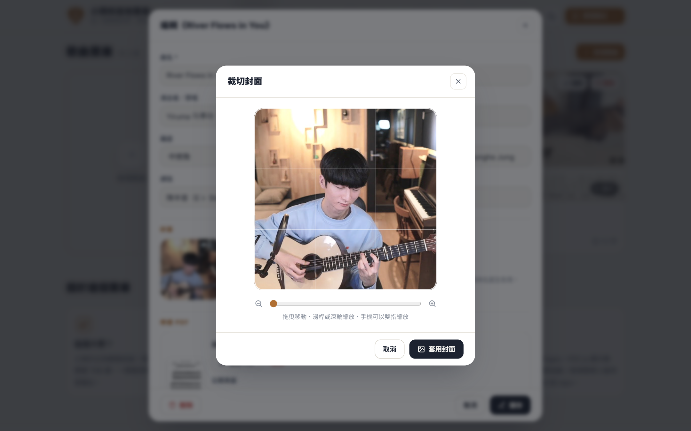

# 小齊的吉他寶庫 🎸

我的吉他練習紀錄網站：每首歌一個方塊，點進去可以一邊看 TAB 譜、一邊看吉他影片，旁邊還有節拍器和練習筆記。

**網站：** https://changdustin.github.io/Dustin_Guitar_Treasure/
**規格書：** [規格書.md](規格書.md)



## 功能

- **歌曲方塊**：正方形封面、難度徽章、練習狀態；滑鼠移過去會 3D 傾斜。可以切換成仿探吉日的雙欄列表。
- **搜尋與篩選**：曲名／演出者／標籤搜尋（按 `/` 快速聚焦）、難度、練習狀態、排序、🎲 隨機抽一首。
- **歌曲頁**：左上歌名、下方吉他影片（YouTube 或影片檔，可放多支切換）；右邊用 PDF.js 滑動預覽樂譜，可縮放、全螢幕。
- **節拍器**：自動帶入每首歌的 BPM。
- **可以彈的吉他指板**：首頁 6 弦 × 12 格，點弦會發出對應音高，開聲音後滑過可以刷弦。
- **管理者模式**：密碼登入後才看得到新增／編輯／刪除；封面可上傳照片或擷取 YouTube 縮圖、樂譜第一頁，再拖曳縮放裁成方形；付費譜可只公開指定頁。
- **一鍵發布**：修改先存成草稿，按「發布到網站」用 GitHub API 一次 commit 回這個 repo，GitHub Pages 自動更新。
- 支援手機版、深色模式。

| 歌曲頁 | 管理模式 |
|---|---|
|  |  |
|  |  |

## 檔案結構

```
index.html          整個網站（HTML + CSS + JS）
data/songs.json     歌曲資料
assets/covers/      方形封面
assets/tabs/        樂譜 PDF（付費譜只放公開預覽頁）
assets/videos/      上傳的影片檔（選用）
規格書.md            網站規格書
```

## 本機預覽

```bash
python -m http.server 8000
```

然後打開 http://localhost:8000 （直接雙擊 index.html 會讀不到 songs.json）。

## 版權

樂譜版權屬原作者與販售平台，付費樂譜在這裡只公開 1～2 頁作為預覽，完整樂譜請到原平台購買。影片版權屬原上傳者，本站只嵌入播放。

---
中央大學 資工二 張紘齊｜第五週作業：用 Vibe Coding 做出一個互動網頁
